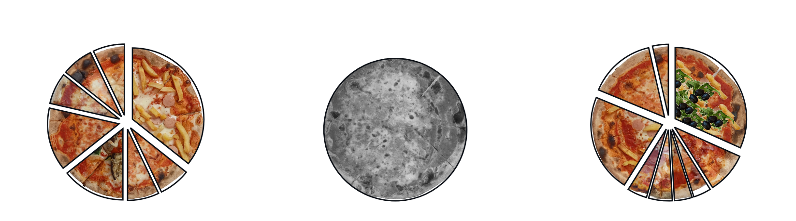

# Pizza chart

Pie charts, with a salty twist.

The purpose of this repository is to create a fun data visualization project to show our pizza preferences during pizza days at work. 
Data and the following summary stats refer to the pizza days at *Polo Territoriale di Lecco, Politecnico di Milano*.

While the data and summary stats are specific to our team, the core plotting function (`pizza_chart.plot`) and example notebooks are designed for anyone to use, adapt, and enjoy for their own pizza events or data visualization needs. See the rest of this README for more info.


<!-- Adaptation to color scheme taken from https://stackoverflow.com/questions/65413712/changing-readme-md-image-display-conditional-to-github-light-mode-dark-mode -->
<br />
<picture>
  <source media="(prefers-color-scheme: dark)" srcset="https://github.com/Luca-Pozzi/pizza_chart/raw/master/assets/charts/summary_dark.png">
  <source media="(prefers-color-scheme: light)" srcset="https://github.com/Luca-Pozzi/pizza_chart/raw/master/assets/charts/summary_light.png">
  
</picture>
<br />

More stats are available on [GitHub Pages](https://luca-pozzi.github.io/pizza_chart/).

---

## Table of contents
* [How to install](#how-to-install)
* [How to use](#how-to-use)
  * [Examples](#examples)
  * [Contribute](#contribute)
    * [Add pizza image](#add-a-pizza-image-)
    * [Add topping image](#add-a-topping-image-)
    * [Add order](#add-an-order-)
* [GitHub Actions](#github-actions)
  * [Deploy to PythonAnywhere](#deploy-to-pythonanywhere)
* [License](#license)
* [Author](#author)

## How to install
1. Clone the repo
  ```
  git clone https://github.com/Luca-Pozzi/pizza_chart.git
  ```
2. Install the requirements (:warning: if you are working in a virtual environment, activate it first!)
  ```
  cd <path_to_pizza_chart>
  pip install -r requirements.txt
  ```


## How to use

> [!IMPORTANT]
> `pizza_chart` comes with built-in images included, which can be freely used for non-commercial purposes (see [license](./LICENSE)).
> In using `pizza_chart`, the user can also use contents from any source, including third-party images. **It is the user's responsibility to give proper attribution to the authors of said contents.**

### Examples
* [`pizza_chart.ipynb`](./examples/pizza_chart.ipynb)
<br>Demonstrates how to use the `pizza_chart.plot` function to visualize pizza orders as a custom pie chart. Shows how to specify your order and customize the chart’s appearance.

* [`pizza_maker.ipynb`](./examples/pizza_maker.ipynb)
<br>Lets you create new pizza images by combining base pizzas and toppings. Useful for generating assets for new pizza types, with interactive controls for customizing your pizza.

### Contribute
#### Add a pizza image :pizza:
To add a new pizza to the assets, you have two main options:
* **Upload a picture.** Take a top-view picture of your pizza, ensuring that it is entirely visible.
Follow the tips in [`assets/README.md`](./assets/README.md) to process it to the desired format, size and resolution.
* **Make a pizza with `pizza_maker.ipynb`.** See [_Examples_ section](#make-a-pizza-with-pizza_makeripynb).

#### Add a topping image :tomato:
Users can add toppings to the assets by either:
* cropping a pizza from the images in [`assets/pizza`](./assets/pizzas)
* getting ingredients images from third-party sources ([Flaticon.com](https://www.flaticon.com/) is a great place to look, if you are down with a cartoonish style).

#### Add an order :clipboard:
> [!NOTE]
> Adding new orders is reserved for collaborators who have write access to this repo.

Data collected during pizza days at [Politecnico di Milano - Polo Territoriale di Lecco](https://www.polo-lecco.polimi.it/) are available in [data.csv](./data/data.csv) CSV file.
The [`pizza_report.py`](./pizza_report.py) gathers data from the CSV files to generate summary charts regarding our pizza days. 
The updated summary is displayed at the top of this [`README`](README.md). Individual charts are available in [`assets/charts`](./assets/charts/).

If you are a collaborator who wants to append new data:
* update the `input/data.csv` file 
* add new pizza images (with background removed, see [`assets/README.md`](./assets/README.md)) in `input/assets/pizzas` (if any)
* push your changes
* manually trigger the _Add new order_ worflow from the _Actions_ tab on GitHub

## GitHub Actions
### Deploy to PythonAnywhere

The [Deploy to PythonAnywhere workflow](./.github/workflows/deploy-pythonanywhere.yml)
runs when `app/`, `src/pizza_chart/`, `requirements.txt`, or `pyproject.toml`
changes. It deploys `app/` to `/home/<username>/data`, the package to
`/home/<username>/src/pizza_chart`, and the two project metadata files to
`/home/<username>`. It then installs the requirements in the configured
PythonAnywhere virtual environment and, when configured, reloads the web app.
The existing `/home/<username>/data/data.db` file is preserved.

Before using the workflow, configure these repository secrets:

* `PA_USERNAME`: PythonAnywhere username.
* `PA_SSH_HOST`: SSH host, normally `ssh.pythonanywhere.com`.
* `PA_SSH_KEY`: private Ed25519 key whose public key is authorized in
  PythonAnywhere.
* `PA_KNOWN_HOSTS`: output of
  `ssh-keyscan -H <PA_SSH_HOST>` obtained and verified manually.
* `PA_VENV_PATH`: absolute path to the PythonAnywhere virtual environment,
  for example `/home/<username>/.virtualenvs/pizzachart`.
* `PA_WEBAPP_DOMAIN`: web app host name without `https://`, for example
  `<username>.pythonanywhere.com`.
* `PA_API_TOKEN`: PythonAnywhere API token with permission to reload the web
  app. If omitted, deployment still completes but the web app is not
  reloaded automatically.

The PythonAnywhere web app must already be configured to use the deployed WSGI
module and virtual environment. The workflow does not modify WSGI
configuration, environment variables, or persistent files such as the SQLite
database.


---

## License
This project is licensed under the [Creative Commons Attribution-NonCommercial 4.0 International License (CC BY-NC 4.0)](LICENSE).

You are free to share and adapt the material for non-commercial purposes, as long as you provide appropriate credit. You can attribute this project as
```
[Pizza chart](https://github.com/Luca-Pozzi/pizza_chart)
```

---

## Author
* Luca :envelope: [luca6.pozzi@mail.polimi.it](mailto:luca6.pozzi@mail.polimi.it)
